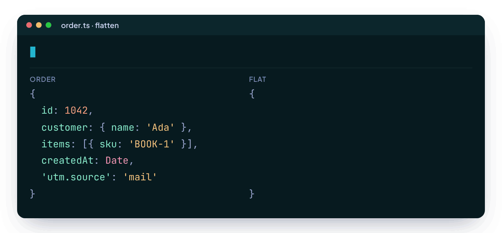
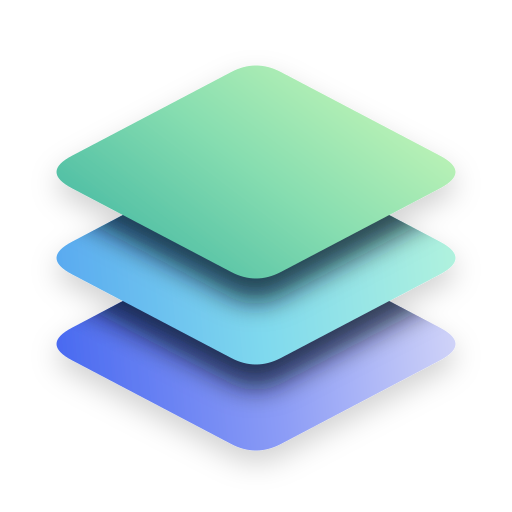

<div align="center">

<a href="https://github.com/NandoMB/flattify">
  <picture>
    <source media="(prefers-color-scheme: dark)" srcset="https://raw.githubusercontent.com/NandoMB/flattify/main/.github/assets/logo-dark.svg">
    
  </picture>
</a>

<h3>Flatten nested objects into <code>path → value</code> pairs and back. Nothing gets lost, and TypeScript knows every path.</h3>

[](https://www.npmjs.com/package/flattify)
[](https://jsr.io/@nandomb/flattify)
[](https://jsr.io/@nandomb/flattify)
[](https://github.com/NandoMB/flattify/actions/workflows/main.yml)
[](https://bundlejs.com/?q=flattify)
[](https://www.npmjs.com/package/flattify)
[](#types)
[](./LICENSE)
[](https://socket.dev/npm/package/flattify)

<p>
  <a href="#installation"><b>Install</b></a> ·
  <a href="#quick-start"><b>Quick start</b></a> ·
  <a href="#data-integrity"><b>Data integrity</b></a> ·
  <a href="#why-flattify"><b>Why Flattify?</b></a> ·
  <a href="#use-cases"><b>Use cases</b></a> ·
  <a href="#api"><b>API</b></a> ·
  <a href="#security"><b>Security</b></a>
</p>

<br>

<picture>
  <source media="(prefers-color-scheme: dark)" srcset="https://raw.githubusercontent.com/NandoMB/flattify/main/.github/assets/demo-dark.gif">
  
</picture>

</div>

<br>

<table>
<tr>
<td width="33%" valign="top"><b>Lossless round trip</b><br><sub>Dates, class instances, <code>null</code>, empty objects, keys with dots and key order come back the way they went in. <a href="#data-integrity">See how</a>.</sub></td>
<td width="33%" valign="top"><b>Safe on untrusted input</b><br><sub>Hostile keys can't pollute prototypes or allocate huge arrays, and deep or circular objects can't overflow the stack.</sub></td>
<td width="33%" valign="top"><b>Typed end to end</b><br><sub>Hover the result to see every path. <code>get</code> and <code>set</code> autocomplete paths and check values.</sub></td>
</tr>
<tr>
<td valign="top"><b>Three notations</b><br><sub><code>a.b.0</code>, <code>a.b[0]</code> for HTML forms, and <code>/a/b/0</code> for JSON Pointer.</sub></td>
<td valign="top"><b>Tested in CI</b><br><sub>100% test coverage, thousands of random round trips per run, and a test behind every <a href="#why-flattify">comparison</a> with other libraries.</sub></td>
<td valign="top"><b>Zero dependencies</b><br><sub>ESM and CommonJS. Runs on Node.js, Bun, Deno, browsers and Cloudflare Workers.</sub></td>
</tr>
</table>

> [!TIP]
> Upgrading from Flattify 1.x? See [Migrating](#migrating).

## Installation

```sh
npm add flattify    # or: pnpm add flattify / yarn add flattify
```

From JSR (Deno, Bun and Node.js):

```sh
deno add jsr:@nandomb/flattify
npx jsr add @nandomb/flattify    # or: bunx jsr add @nandomb/flattify
```

## Quick start

```ts
import { flatten, unflatten } from 'flattify';
// CommonJS: const { flatten, unflatten } = require('flattify');

const order = {
  id: 1042,
  customer: { name: 'Ada Lovelace' },
  items: [
    { sku: 'BOOK-1', qty: 2 },
    { sku: 'PEN-7', qty: 1 },
  ],
  shipping: { method: null },
  'utm.source': 'newsletter',
};

const flat = flatten(order);
// {
//   'id': 1042,
//   'customer.name': 'Ada Lovelace',
//   'items.0.sku': 'BOOK-1',
//   'items.0.qty': 2,
//   'items.1.sku': 'PEN-7',
//   'items.1.qty': 1,
//   'shipping.method': null,
//   'utm\\.source': 'newsletter',   // escaped, so the dot survives the way back
// }

const back = unflatten(flat); // equals `order` again
```

Both results are typed:

```ts
flat['items.0.sku'];      // string
flat['customer.phone'];   // ❌ Property 'customer.phone' does not exist
back.items[0].sku;        // string
```

It works like serializing and deserializing, except that both sides are JavaScript objects and only the shape changes. Data that arrives flat, such as form fields, query strings, environment variables or CSV columns, can go straight into `unflatten`, which is safe to use on it.

## Data integrity

Many libraries lose something on the way. A `Date` or a `null` is dropped, a class instance is taken apart, an empty list vanishes, or `'utm.source'` is split in two. Flattify keeps all of it:

```ts
const input = {
  createdAt: new Date(),
  price: new Money(1990),   // a class instance
  discount: null,
  coupon: undefined,
  items: [],
  meta: {},
  'utm.source': 'newsletter',
  sizes: ['S', , 'L'],      // an array with a hole
};

const back = unflatten(flatten(input));

back.createdAt === input.createdAt;  // true: the same Date, not {} or a copy
back.price instanceof Money;         // true
back.discount;                       // null
'coupon' in back;                    // true
back.items;                          // []
back['utm.source'];                  // 'newsletter', still one key
1 in back.sizes;                     // false: the hole is still a hole
```

In detail:

- Flattify only walks plain objects and arrays. `Date`, `Map`, `Set`, `RegExp`, typed arrays, functions and class instances are kept by reference and never converted.
- `null`, `undefined`, empty objects and empty arrays are all kept.
- A key that contains the delimiter is escaped (`'utm\\.source'`). Other keys are never changed.
- Keys come out depth first in input order, and `unflatten` puts them back in the same order.
- Your input is never modified. `unflatten` copies any object it finds in its input before adding keys to it.
- Only indices like `0` or `42` build arrays, up to [`arrayLimit`](#unflatteninput-options). Keys like `'01'` or `'1e3'` stay object keys.
- A circular reference throws an error that names its path. Depth has no limit; 100,000 levels work.

The test suite covers each of these, and every run checks the round trip on thousands of random objects with [fast-check](https://fast-check.dev), in every notation.

## Why Flattify?

[`bench/claims.spec.ts`](./bench/claims.spec.ts) checks every row of this table against flat 6.0.1, flattie 1.1.1, nestie 1.0.3, es-toolkit 1.53.0 and radashi 13.0.1 on each CI run (`pnpm claims`).

| | Flattify | [flat](https://www.npmjs.com/package/flat) | [flattie](https://www.npmjs.com/package/flattie) / [nestie](https://www.npmjs.com/package/nestie) | [es-toolkit](https://www.npmjs.com/package/es-toolkit) | [radashi](https://www.npmjs.com/package/radashi) |
| --- | --- | --- | --- | --- | --- |
| Keys with the delimiter survive the round trip | ✅ | ❌ | ❌ | – | ❌ |
| Keeps `Date` and `Map` as values | ✅ | ✅ | ❌ dropped | ✅ | ✅ |
| Keeps class instances as values | ✅ | ❌ | ❌ | ✅ | ❌ |
| Keeps `null` values | ✅ | ✅ | ❌ dropped | ✅ | ✅ |
| Keeps empty objects and arrays | ✅ | ✅ | ❌ dropped | ✅ | ✅ |
| Circular references | ✅ clear error | ❌ stack overflow | ❌ stack overflow | ❌ stack overflow | ❌ stack overflow |
| Deeply nested input (100k levels) | ✅ | ❌ stack overflow | ❌ stack overflow | ❌ stack overflow | ❌ stack overflow |
| Limit on array indices when unflattening | ✅ | ❌ | ❌ | – | ❌ |
| Paths and values inferred by TypeScript | ✅ | ❌ you pass the type | ❌ | ❌ `Record<string, any>` | ❌ `Record<string, …>` |
| `unflatten` | ✅ | ✅ | ✅ | ❌ | ✅ |
| Bracket notation and JSON Pointer | ✅ | ❌ | ❌ | ❌ | ❌ |
| `get` / `set` with autocompleted paths | ✅ | ❌ | ❌ | ❌ | ❌ |
| ESM and CommonJS | ✅ | ❌ v6 is ESM only | ✅ | ✅ | ✅ |
| Size (min + gzip) | 2.3 kB | 0.7 kB | 0.35 kB | 0.34 kB | 0.8 kB |

The extra size pays for the checks above, the three notations, key escaping and the error messages. `flattify/path` is a separate import, so it only adds to your bundle when you use it.

## Use cases

### HTML forms

Field names like `address[city]` or `items[0][qty]` become a nested object. Keys like `__proto__[isAdmin]` from a malicious client are ignored.

```ts
const body = unflatten(Object.fromEntries(new FormData(form)), { notation: 'bracket' });
// { name: 'Ada', address: { city: 'London' }, items: [{ sku: 'BOOK-1', qty: '2' }] }
```

### Query strings

From an object to a query string and back:

```ts
const flat = flatten({ status: 'open', tags: ['a', 'b'] }, { notation: 'bracket' });
const query = new URLSearchParams(Object.entries(flat).map(([k, v]) => [k, String(v)]));
// status=open&tags[0]=a&tags[1]=b (with the brackets percent-encoded)

unflatten(Object.fromEntries(new URLSearchParams(location.search)), { notation: 'bracket' });
// { status: 'open', tags: ['a', 'b'] }
```

### Environment variables

With `'__'` as the delimiter, `APP__DB__MAX_CONN` becomes `app.db.max_conn`:

```ts
const env = unflatten(process.env, { delimiter: '__', transformKey: (key) => key.toLowerCase() });
env.app; // { db: { host: 'localhost', max_conn: '10' } }
```

### CSV and spreadsheets

Flatten each record into one row, and the keys become the headers:

```ts
const rows = users.map((user) => flatten(user));
// [{ id: 1, name: 'Ada', 'address.city': 'London' }, ...]

// Or flatten the whole list into one object and get the list back:
const same = unflatten(flatten(users), { asArray: true });
```

### MongoDB partial updates

`$set` with flat paths changes only those fields:

```ts
await users.updateOne({ _id }, { $set: flatten({ profile: { name: 'Ada' } }) });
// $set: { 'profile.name': 'Ada' }: the other profile fields are kept
```

### JSON Schema errors

Validators like Ajv report errors as JSON Pointers, and `get` reads them directly:

```ts
get(data, error.instancePath, { notation: 'pointer' }); // e.g. '/items/0/qty'
```

People also use it for typed translation files (`messages['home.title']`), structured logs for Datadog or Elasticsearch, and diffing two objects by comparing their flat forms.

## API

### `flatten(input, options?)`

Takes a plain object or array and returns a new flat object. Values are not cloned.

| Option | Default | |
| --- | --- | --- |
| `delimiter` | `'.'` | Joins the keys: `{ delimiter: '__' }` → `db__host` |
| `notation` | `'dot'` | `'dot'`, `'bracket'` or `'pointer'` (see [notations](#notations)) |
| `maxDepth` | `Infinity` | Levels to walk; deeper objects are kept as values. `1` keeps only top-level keys |
| `safe` | `false` | Keeps arrays as values: `{ 'user.tags': ['a', 'b'] }` instead of `user.tags.0`, `user.tags.1` |
| `keepEmpty` | `true` | Keeps empty objects and arrays; `false` drops them |
| `escape` | `true` | Escapes keys containing the delimiter (`'utm\\.source'`); `false` leaves them as is |
| `circular` | `'throw'` | On a circular reference, throws a `TypeError` with its path; `'skip'` leaves the key out |
| `transformKey` | | Renames each object key: `(key) => key.toUpperCase()`. Keys are then typed as `string` |
| `preserve` | | `(path, value) => boolean`: `true` keeps that object or array as a value |

With a longer delimiter, Flattify escapes only the keys that would be ambiguous. With `'__'`, `MAX_CONN` stays as is, but `MAX_` is escaped because its trailing `_` would merge with the delimiter.

### `unflatten(input, options?)`

Takes a flat object and returns a new nested object. Index keys build arrays in any order. The top level is always an object unless `asArray` is set.

| Option | Default | |
| --- | --- | --- |
| `delimiter` | `'.'` | Splits keys into paths |
| `notation` | `'dot'` | `'dot'`, `'bracket'` or `'pointer'` (see [notations](#notations)) |
| `asArray` | `false` | Returns an array: `{ '0.id': 1, '1.id': 2 }` → `[{ id: 1 }, { id: 2 }]`. A top-level key that isn't an index throws |
| `object` | `false` | Never builds arrays: `{ 'list.0': 'a' }` → `{ list: { 0: 'a' } }` |
| `overwrite` | `false` | When a path goes through a value (`{ a: 1, 'a.b': 2 }`), replaces it (`{ a: { b: 2 } }`) instead of skipping the path |
| `arrayLimit` | `1000` | Larger indices become object keys, so `'a.4294967294'` can't allocate a huge array |
| `escape` | `true` | Reads `\` as an escape, as `flatten` writes it |
| `transformKey` | | Renames each key of the path (not array indices) |

### Notations

Every function takes `notation`, and the inferred types follow it:

| `notation` | Path | Useful for |
| --- | --- | --- |
| `'dot'` (default) | `items.0.sku` | Config, translations, MongoDB, logs |
| `'bracket'` | `items[0].sku` | HTML forms and query strings. `unflatten` also reads `items[0][sku]` |
| `'pointer'` | `/items/0/sku` | [JSON Pointer](https://www.rfc-editor.org/rfc/rfc6901): JSON Patch, JSON Schema errors. `~` and `/` are written `~0` and `~1` |

### `flattify/path`

Read and write one value by path, with the path autocompleted and the value typed:

```ts
import { get, set, has, del, paths } from 'flattify/path';

get(order, 'items.0.sku');       // 'BOOK-1', typed string | undefined

set(config, 'db.port', 6543);    // ✅
set(config, 'db.port', '6543');  // ❌ type error: string is not number
set(config, 'db.prot', 6543);    // ❌ type error: no such path
```

| Function | |
| --- | --- |
| `get(obj, path)` | The value at `path`, or `undefined` if a key is missing |
| `set(obj, path, value)` | Sets the value, creating missing objects and arrays; returns `obj` |
| `has(obj, path)` | `true` if every key of the path exists |
| `del(obj, path)` | Deletes the key; `true` if it existed |
| `paths(obj)` | The paths `flatten` produces |
| `parsePath(path)` / `stringifyPath(keys)` | `'a\\.b.c'` ↔ `['a.b', 'c']` |
| `escapeKey(key)` | Escapes one key: `` `user.${escapeKey(field)}` `` |

Each function takes `delimiter`, `notation` and `escape` as its last argument, and each is safe to call with untrusted paths.

## Types

The types compute paths and values for every option that changes them:

```ts
flatten({ user: { tags: ['admin'] } });
// { [x: `user.tags.${number}`]: string; 'user.tags'?: [] }

flatten({ a: { b: 1 } }, { notation: 'pointer' });
// { '/a/b': number }
```

Arrays give `` `${number}` `` keys and tuples give exact indices. Optional or nullable objects give optional paths, and unions are merged. `Date`, `Map` and other built-ins stay as values. For plain data, `Unflatten<Flatten<T>>` gives back `T`.

When an option is only known at runtime (a `string` delimiter, `transformKey` or `preserve`), keys are typed as `string`.

Exported types: `Flatten<T, Options>` and `Unflatten<T, Options>`, plus `Path<T>`, `Get<T, Path>` and `SetValue<T, Path>` from `flattify/path`.

## Limitations

- Some round trips can't be exact. An object with only index keys (`{ '0': 'a' }`) comes back as an array. An array given to `flatten` comes back as an object unless `unflatten` gets `{ asArray: true }`. And `transformKey` needs its inverse on the way back.
- Symbol keys are ignored, as `JSON.stringify` ignores them.
- TypeScript can't tell a class instance from a plain object, so class instances are typed as if they were flattened. Paths are typed down to 10 levels, and as `unknown` below that.
- In bracket notation, an empty top-level key holding an array (`{ '': [1] }`) looks the same as the array itself.

## Compatibility

| | |
| --- | --- |
| Runtimes | Node.js, Bun, Deno, browsers (ES2015), Cloudflare Workers |
| Modules | ESM and CommonJS |
| TypeScript | 5.0+, any `moduleResolution` |

CI runs the tests on Node.js 22, 24 and 26, Bun, Deno, Chromium, Firefox, WebKit and workerd (the Cloudflare Workers runtime). It also checks the package with [publint](https://publint.dev) and [Are the Types Wrong?](https://arethetypeswrong.github.io).

## Migrating

### From `flat`

The options have the same names (`delimiter`, `maxDepth`, `safe`, `object`, `overwrite`, `transformKey`), but some defaults are safer:

| | `flat` | Flattify |
| --- | --- | --- |
| Result type | you pass it: `flatten<T, R>()` | inferred |
| Keys with the delimiter | split in two on the way back | escaped; `{ escape: false }` for the old behavior |
| `maxDepth: 0` | no limit | `RangeError`: leave it out for no limit |
| `unflatten({ a: { 'b.c': 1 } })` | `{ a: { b: { c: 1 } } }` | values are kept as they are |
| `unflatten` of a non-object | returned as it is | `TypeError` |
| Class instances | flattened | kept as values |
| Circular references | stack overflow | `TypeError`, or `circular: 'skip'` |

### From Flattify 1.x

2.0 is a rewrite with named exports:

| 1.x | 2.x |
| --- | --- |
| `flattify(obj, true)` | `flatten(obj)` |
| `flattify(obj)` (arrays turned into JSON strings) | `flatten(obj, { safe: true })` (arrays kept as arrays) |
| `flattify(array)` (each item flattened) | `array.map((item) => flatten(item))` |
| `flattify(jsonString)` | `flatten(JSON.parse(jsonString))` |

2.0 also fixes nested arrays losing their path: `{ a: { tags: [1] } }` gave `{ tags: '[1]' }` and now gives `{ 'a.tags.0': 1 }`.

## Security

- `unflatten` and `set` only create own properties, and they skip any path through `__proto__` in every notation, so they can't pollute prototypes. (`flat` had this flaw as [CVE-2020-36632](https://nvd.nist.gov/vuln/detail/CVE-2020-36632), fixed in 5.0.1.)
- Objects are walked with an explicit stack instead of recursion, so deep input can't overflow the stack, and a circular reference throws an error that names its path.
- `arrayLimit` caps the indices that `unflatten` turns into arrays, so a key like `'a.4294967294'` can't allocate a huge one.
- The bracket parser takes linear time, even on hostile input like `a[[[[...`.

The test suite covers all of this, and it fuzzes `unflatten` with random paths built from `__proto__`, `constructor` and `prototype`. Releases are published from GitHub Actions with [npm provenance](https://docs.npmjs.com/generating-provenance-statements), and each one is [staged](https://docs.npmjs.com/staged-publishing/) until it is approved with 2FA.

Found a vulnerability? Please report it privately, as described in [SECURITY.md](./SECURITY.md).

## License

<p align="center">
  <br>
  <a href="./LICENSE">MIT</a> © 2016 <a href="https://github.com/NandoMB">Fernando Machado Bernardino</a><br>
  <sub>If Flattify saves you time, a ⭐ on <a href="https://github.com/NandoMB/flattify">GitHub</a> helps others find it.</sub>
</p>
